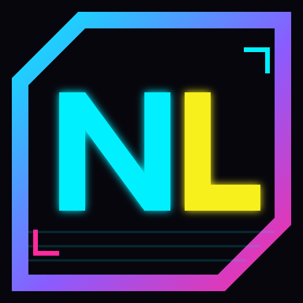
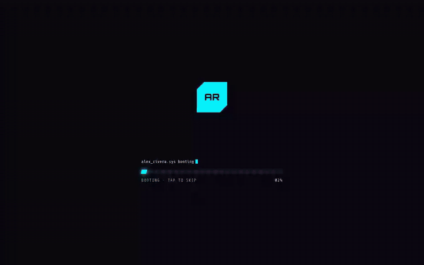
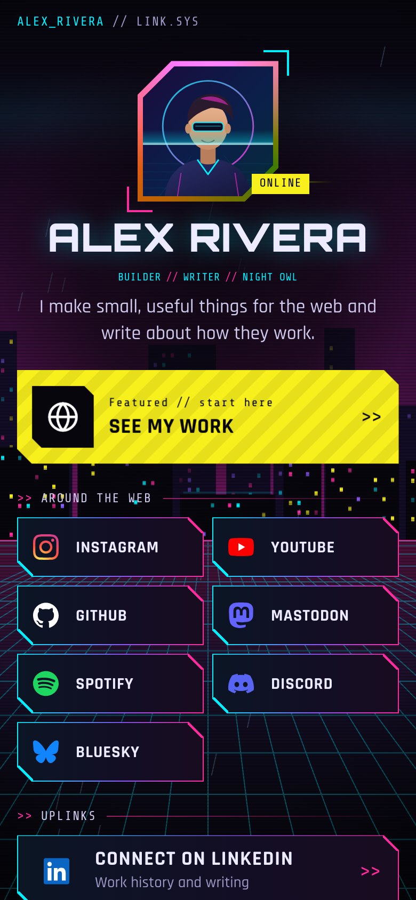
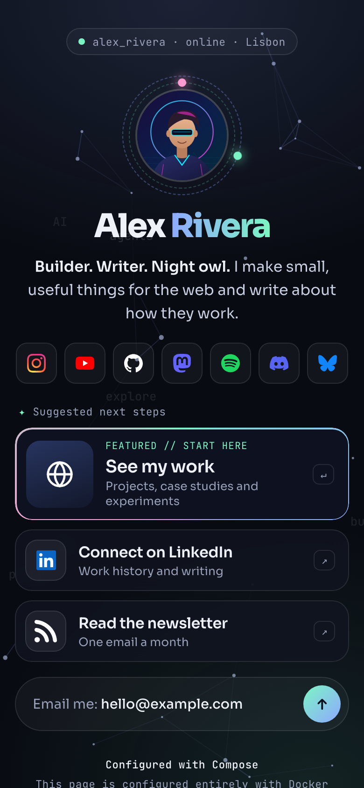
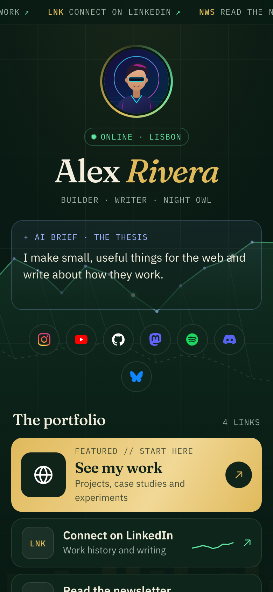
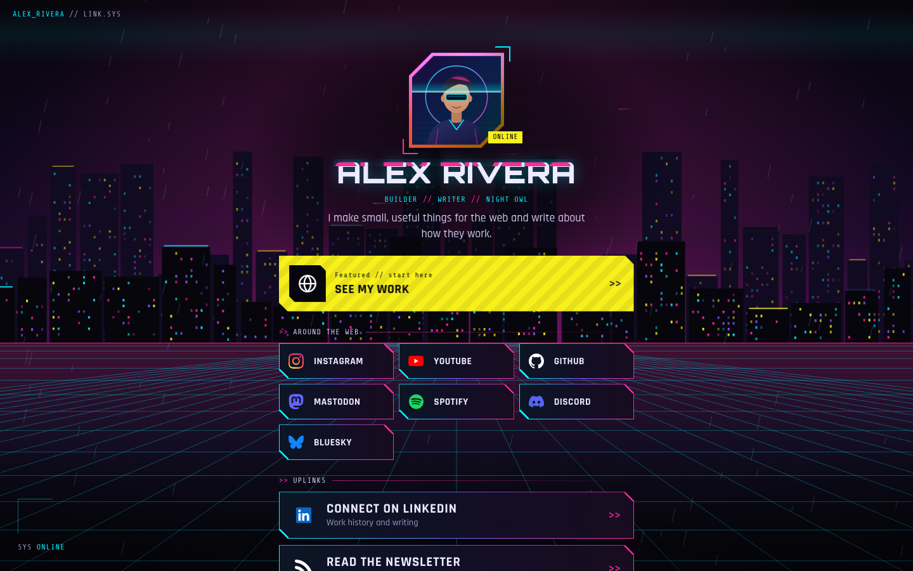
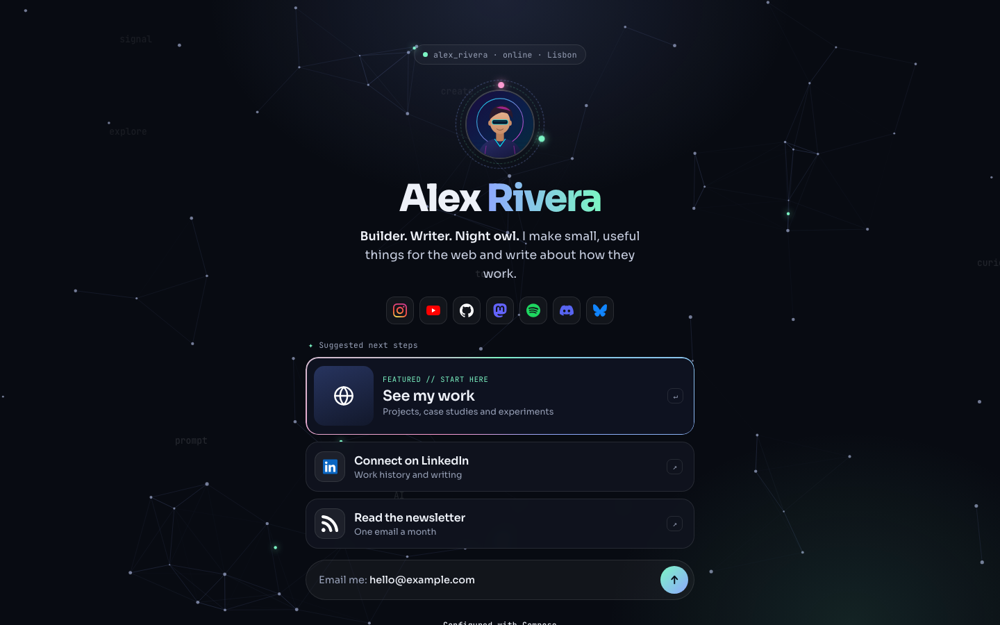
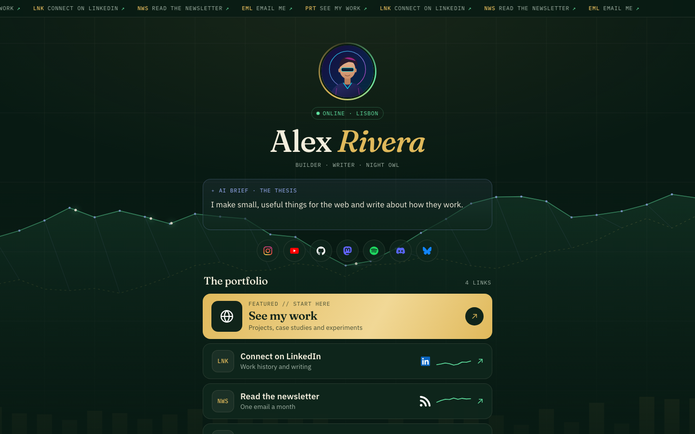
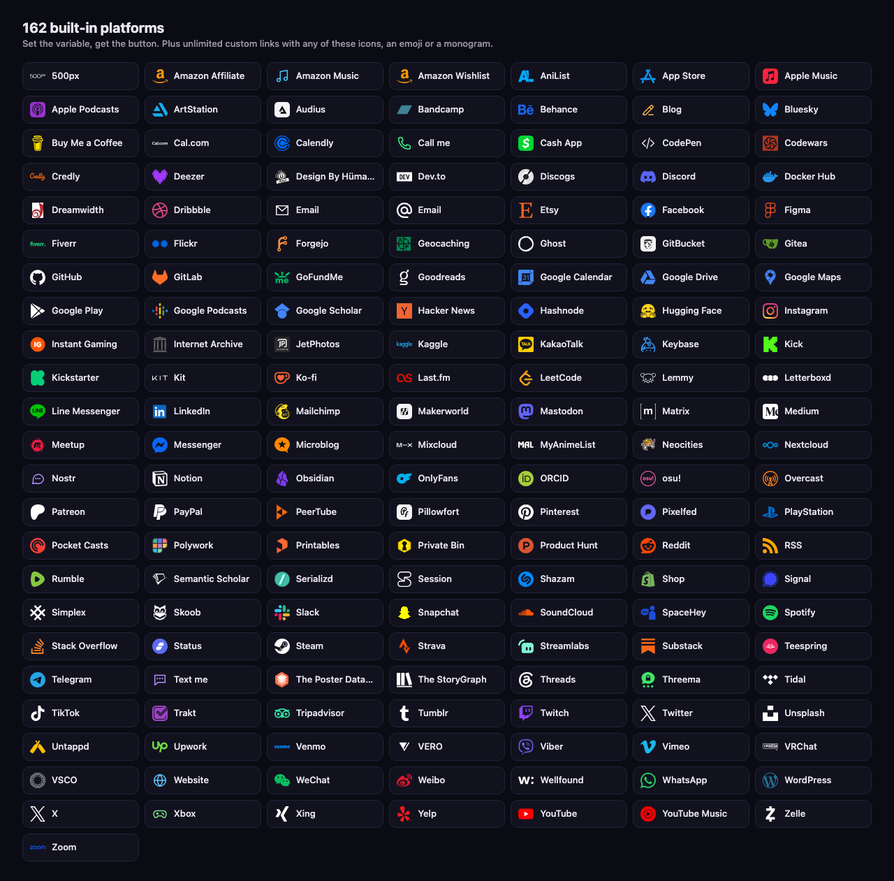

<p align="center">
  
</p>

<h1 align="center">NeonLink</h1>

<p align="center"><strong>Your links, lit up.</strong> A self-hosted link-in-bio page with a cyberpunk boot sequence, configured entirely with Docker environment variables.</p>

<p align="center">
  <a href="https://github.com/The-Digital-Dev/neonlink/actions/workflows/ci.yml"></a>
  <a href="https://github.com/The-Digital-Dev/neonlink/pkgs/container/neonlink"></a>
  
  
  <a href="LICENSE"></a>
</p>

<p align="center">
  <picture>
    <source type="image/webp" srcset="docs/images/hero.webp">
    
  </picture>
  <br><sub>The real app with the sample profile. <a href="docs/images/hero.mp4">Watch as MP4</a>.</sub>
</p>

<p align="center">
  <strong>Live demos:</strong> Neon · Neural · Opening Bell <em>(coming soon on GitHub Pages)</em>
</p>

No database, no admin panel, no build step: set the variables, start the container, and the page is
live. NeonLink reads the same variable names as
[littlelink-server](https://github.com/timothystewart6/littlelink-server), so an existing Compose file
works as it is, and it ships with three designs you switch with one variable.

- **Three themes:** Neon (cyberpunk night city), Neural (an AI answering "who is this?") and
  Opening Bell (a calm investing app). Same content, one `THEME` variable.
- **162 built-in platforms** with coloured logos ([see them all](docs/platforms.md)), plus unlimited
  custom links with any of those logos, an emoji or a monogram.
- **Tiny and locked down:** one Node.js process with zero dependencies, a strict
  Content-Security-Policy, a read-only non-root container, images for amd64 and arm64.
- **Accessible:** keyboard friendly, reduced-motion support, and it works with JavaScript off.
- **Optional analytics:** Google Analytics, Umami, Matomo, Plausible or Cloudflare, only when set.

## Theme gallery

| Neon (default) | Neural | Opening Bell |
| --- | --- | --- |
|  |  |  |
| `THEME=neon` | `THEME=neural` | `THEME=opening-bell` |

<details>
<summary><strong>Desktop screenshots</strong></summary>







</details>

All pictures show **Alex Rivera**, an invented sample person; the avatar is an illustration. They
are regenerated from [compose.yaml](compose.yaml) with `make media`.

## Quick start (30 seconds)

**Docker:**

```bash
docker run -d --name neonlink -p 127.0.0.1:8080:3000 --read-only \
  -e NAME="Alex Rivera" -e BIO="Builder | Writer | Night owl" \
  -e GITHUB=https://github.com/ -e EMAIL=hello@example.com \
  ghcr.io/the-digital-dev/neonlink:latest
```

Open http://127.0.0.1:8080/. Change a value, run the command again (after `docker rm -f neonlink`),
and reload.

**Docker Compose:** save this as `compose.yaml`, then run `docker compose up -d`.

```yaml
services:
  links:
    image: ghcr.io/the-digital-dev/neonlink:latest
    restart: unless-stopped
    read_only: true
    cap_drop: [ALL]
    security_opt: ["no-new-privileges:true"]
    ports:
      - "127.0.0.1:8080:3000"
    volumes:
      - ./media:/app/media:ro      # optional: put avatar.jpg here
    environment:
      NAME: Alex Rivera
      BIO: Builder | Writer | Night owl
      THEME: neon                  # or neural, opening-bell
      GITHUB: https://github.com/alex
      LINKED_IN: https://www.linkedin.com/in/alex
      EMAIL: alex@example.com
      CUSTOM_BUTTON_NAME: PORTFOLIO
      CUSTOM_BUTTON_TEXT: See my work
      CUSTOM_BUTTON_URL: https://example.com/
```

The page is rendered at start-up, so `docker compose up -d` after an edit applies it. Without
Docker: `HOST=127.0.0.1 MEDIA_DIR=./media node app/server.mjs` with Node.js 20 or newer and the
variables in the environment (the defaults bind every interface and read `/app/media`).

## Make it yours

Every visible word and every link is an environment variable, and all of them are optional. These
are the ones most people change; the [configuration reference](docs/configuration.md) has all of them.

| Variable | Example | What it does |
| --- | --- | --- |
| `NAME` | `Alex Rivera` | Your name in the heading, title and footer |
| `BIO` | `Builder \| Writer \| Night owl` | Taglines under the name, separated by `\|` |
| `LEDE` | `I make small, useful things.` | A sentence or two under the taglines |
| `THEME` | `neon`, `neural`, `opening-bell` | The design |
| `<PLATFORM>` | `GITHUB=https://github.com/alex` | A built-in platform link; [162 names](docs/platforms.md) such as `YOUTUBE`, `LINKED_IN`, `X`, `EMAIL`, `PHONE` |
| `<PLATFORM>_TEXT` | `LINKED_IN_TEXT=Connect on LinkedIn` | Label for that link |
| `LINK_<n>_URL` / `_TEXT` / `_ICON` | `https://…` / `Visit my shop` / `etsy` | Your own links, one field per line ([custom links](#custom-links)); the littlelink-server `CUSTOM_BUTTON_*` lists work too |
| `PRIMARY_BUTTONS` | `PORTFOLIO,LINKED_IN,EMAIL` | Links shown as large cards; the rest form the compact grid |
| `FEATURED_BUTTON` | `PORTFOLIO` | The big featured card (`none` hides it) |
| `BUTTON_ORDER` | `PORTFOLIO,GITHUB,EMAIL` | Order of links |
| `AVATAR_URL` | `/media/me.jpg` | Profile picture (or drop `avatar.jpg` in the media folder) |
| `BOOT_MODE` | `full`, `short`, `once`, `off` | The loader: full, twice as fast, only on the first visit, or never |
| `OG_URL` | `https://links.example.com/` | Your public address, for share cards and the canonical link |

Lists are comma-separated; write `\,` for a comma inside an item. In Compose, write `$$` for a
literal `$`.

## Supported platforms

<p align="center"></p>

Each one is a variable: set `KOFI=https://ko-fi.com/alex` and the Ko-fi button appears with its logo.
The full list with variable names is in [docs/platforms.md](docs/platforms.md). Want to see every button
in each design? Run `make demo` and open `dist/demo/<theme>/all-platforms/`.

## Custom links

Anything that is not a built-in platform is a custom link: a label, a URL, an optional second line,
an icon and an accent colour. Write them one field per line:

```yaml
      LINK_1_NAME: SHOP
      LINK_1_URL: https://example.com/shop
      LINK_1_TEXT: Visit my shop
      LINK_1_NOTE: Prints and stickers
      LINK_1_ICON: etsy          # any built-in platform's logo, a /media/ file, or an emoji like 🛍️
      LINK_1_COLOR: "#F1641E"    # accent: Neon glow, Neural node, Opening Bell ticker
      LINK_2_URL: https://example.com/talks
      LINK_2_TEXT: Conference talks
      LINK_2_ICON: 🎤
```

With no icon, the link gets a monogram of its first letter in the theme's style. Custom links sort
with everything else in `BUTTON_ORDER`, and any of them can be the featured card. The
littlelink-server comma-list form (`CUSTOM_BUTTON_NAME`, `_URL`, `_TEXT`, `_ICON`, `_COLOR`) works
too; see the [configuration reference](docs/configuration.md#custom-links-one-variable-per-field).

## The loader

Each theme opens with its own short loader: a boot log (Neon), a question being answered (Neural)
or the opening bell (Opening Bell). Out of the box it uses generic wording filled in from your
settings, such as your name and how many links you have. Visitors can tap to skip it, and with
reduced motion turned on it never shows.

```yaml
      BOOT_MODE: once                                   # full (default), short, once or off
      BOOT_LOG: "{first}.os waking up|[OK] Synced {platforms}|[OK] {count} links ready"
      BOOT_QUESTION: what is {first} building?          # Neural
      BOOT_STAGES: Pre-market|Counting {count} links    # Neural and Opening Bell
```

Every token and default is in the [configuration reference](docs/configuration.md#loader-tokens-and-examples).

## Picture and icons

Mount a folder read-only at `/app/media`:

- `avatar.jpg` (or `.png`, `.webp`, `.svg`) becomes the profile picture, `favicon.svg` (or `.png`,
  `.ico`) the favicon. With neither, NeonLink draws an initials avatar and favicon in the theme colours.
- Any other image works by path, for example `CUSTOM_BUTTON_ICON=/media/shop.png`.
- Any built-in platform's logo works for a custom link by name (`LINK_1_ICON: kofi`), and
  `<PLATFORM>_ICON` swaps a platform's logo for your own picture.

## Themes

| Theme | Look | Loader |
| --- | --- | --- |
| `neon` (default) | Cyberpunk night city, glitch effects, cut-corner panels | Typed boot log, block meter, "Access granted" |
| `neural` | Dark AI answer over a drifting neural network | The question types itself and the bio streams in |
| `opening-bell` | Calm investing app; links as positions with tickers | A chart draws, the bell rings, the curtain lifts |

Each theme has its own default wording, which your variables override. How to build your own:
[docs/themes.md](docs/themes.md).

## Putting it online

NeonLink is one container on port 3000 with no database and no secrets. Put it behind what you
already use: Caddy, Nginx, Traefik, Nginx Proxy Manager, a Portainer stack or a Cloudflare Tunnel.
Examples for each, plus static hosting on GitHub Pages, are in [docs/deploying.md](docs/deploying.md).

## Coming from LittleLink

If you run [littlelink-server](https://github.com/timothystewart6/littlelink-server), change the
`image:` line to `ghcr.io/the-digital-dev/neonlink:latest` and keep your environment. Platform
links, `*_TEXT` labels, custom buttons, `BUTTON_ORDER`, metadata and analytics variables keep
working. What changes:

- `THEME` picks a NeonLink design; `dark`, `light` and `auto` select the default (Neon).
- The theme owns colours and shadows, so `DROP_SHADOW`, `THEME_OS`, `AVATAR_SIZE` and
  `CUSTOM_BUTTON_TEXT_COLOR` are accepted and ignored.
- New optional extras: `*_NOTE` second lines, `PRIMARY_BUTTONS`, `FEATURED_BUTTON`, the boot log and
  the media folder.

## Development

```bash
make verify     # repository and leak check + unit tests (Node 20+, nothing to install)
make up         # sample page on http://127.0.0.1:4191/
make browser    # browser checks at 390, 900 and 1440 px (Playwright)
make media      # regenerate screenshots and the hero animation
make demo       # static copies of every theme in dist/demo/
```

See [CONTRIBUTING.md](CONTRIBUTING.md). Contributors and coding agents also follow [AGENTS.md](AGENTS.md).

| Path | Contents |
| --- | --- |
| `app/server.mjs` | HTTP server, static files, media folder, security headers |
| `app/config.mjs` | Environment variables to page model (pure, tested) |
| `app/platforms.mjs` | Built-in platform catalogue |
| `app/themes/<name>/` | Themes: markup, CSS, scripts, fonts |
| `app/public/` | Shared files: platform icons, analytics loader |
| `examples/media/` | The sample avatar |
| `tests/` | Unit and HTTP tests (`node --test`) |
| `scripts/` | Repository and leak checks, browser checks, picture capture, static export |
| `docs/` | Configuration, themes and deployment guides; README images |

## Roadmap

- An optional admin page with drag-and-drop link ordering and picture upload, keeping environment
  variables as the defaults.
- More coloured platform logos and more themes.
- Hosted live demos on GitHub Pages.

Ideas and theme proposals are welcome in the issues.

## Credits

NeonLink is its own code, written from scratch, but the idea comes from two projects worth knowing:

- [LittleLink](https://github.com/sethcottle/littlelink) by Seth Cottle, the original lightweight,
  self-hosted alternative to commercial link-in-bio services.
- [littlelink-server](https://github.com/timothystewart6/littlelink-server) by Techno Tim, which made
  LittleLink configurable with Docker environment variables. NeonLink keeps its variable names and
  its MIT-licensed platform icons.

Coloured logos, fonts and their licences are listed in [THIRD-PARTY-NOTICES.md](THIRD-PARTY-NOTICES.md).
Platform names and logos are trademarks of their owners.

## Licence

[MIT](LICENSE) © 2026 Digital Dev
