# Supported platforms

NeonLink has **162 built-in platforms**. Set the variable to your link and the button
appears with its icon; add `<VARIABLE>_TEXT` for your own label, `<VARIABLE>_NOTE` for a second line and
`<VARIABLE>_ICON` to swap the icon. For anything not listed, use a custom link
([configuration](configuration.md#links)); a custom link can borrow any icon below by its variable,
for example `LINK_1_ICON: kofi` or `CUSTOM_BUTTON_ICON: LINKED_IN`.

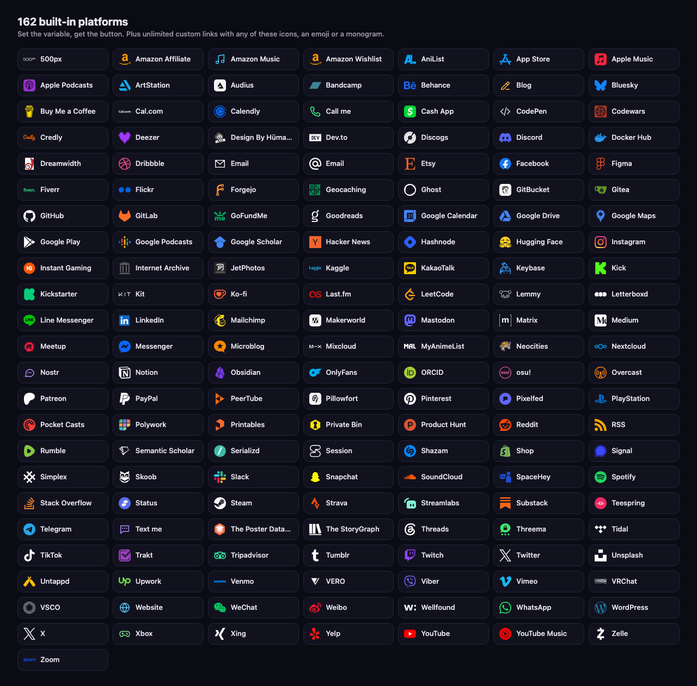

To see every button in each design, open the "all platforms" demo of each theme
(`make demo`, then `dist/demo/<theme>/all-platforms/`).

| Icon | Platform | Variable | Takes |
| --- | --- | --- | --- |
|  | 500px | `FIVEHUNDREDPX` | a link |
|  | Amazon Affiliate | `AMAZON_AFFILIATE` | a link |
|  | Amazon Music | `AMAZON_MUSIC` | a link |
|  | Amazon Wishlist | `AMAZON_WISHLIST` | a link |
|  | AniList | `ANILIST` | a link |
|  | App Store | `APP_STORE` | a link |
|  | Apple Music | `APPLE_MUSIC` | a link |
|  | Apple Podcasts | `APPLE_PODCASTS` | a link |
|  | ArtStation | `ARTSTATION` | a link |
|  | Audius | `AUDIUS` | a link |
|  | Bandcamp | `BANDCAMP` | a link |
|  | Behance | `BEHANCE` | a link |
|  | Blog | `BLOG` | a link |
|  | Bluesky | `BLUESKY` | a link |
|  | Buy Me a Coffee | `BUYMEACOFFEE` | a link |
|  | Cal.com | `CALCOM` | a link |
|  | Calendly | `CALENDLY` | a link |
|  | Call me | `PHONE` | a phone number |
|  | Cash App | `CASHAPP` | a link |
|  | CodePen | `CODEPEN` | a link |
|  | Codewars | `CODEWARS` | a link |
|  | Credly | `CREDLY` | a link |
|  | Deezer | `DEEZER` | a link |
| 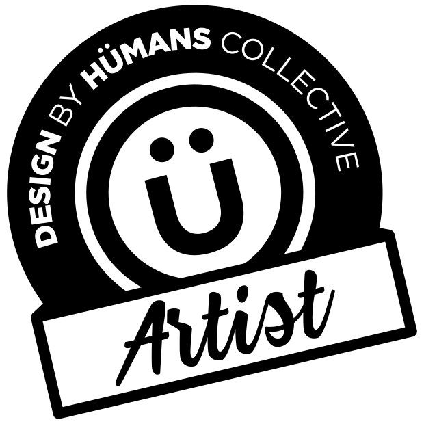 | Design By Hümans | `DESIGNBYHUMANS` | a link |
|  | Dev.to | `DEVTO` | a link |
|  | Discogs | `DISCOGS` | a link |
|  | Discord | `DISCORD` | a link |
|  | Docker Hub | `DOCKERHUB` | a link |
|  | Dreamwidth | `DREAMWIDTH` | a link |
|  | Dribbble | `DRIBBBLE` | a link |
|  | Email | `EMAIL` | an e-mail address |
|  | Email | `EMAIL_ALT` | an e-mail address |
|  | Etsy | `ETSY` | a link |
|  | Facebook | `FACEBOOK` | a link |
|  | Figma | `FIGMA` | a link |
|  | Fiverr | `FIVERR` | a link |
|  | Flickr | `FLICKR` | a link |
|  | Forgejo | `FORGEJO` | a link |
|  | Geocaching | `GEOCACHING` | a link |
|  | Ghost | `GHOST` | a link |
|  | GitBucket | `GITBUCKET` | a link |
|  | Gitea | `GITEA` | a link |
|  | GitHub | `GITHUB` | a link |
|  | GitLab | `GITLAB` | a link |
|  | GoFundMe | `GOFUNDME` | a link |
|  | Goodreads | `GOODREADS` | a link |
|  | Google Calendar | `GOOGLE_CALENDAR` | a link |
|  | Google Drive | `GOOGLE_DRIVE` | a link |
|  | Google Maps | `GOOGLEMAPS` | a link |
|  | Google Play | `GOOGLE_PLAY` | a link |
|  | Google Podcasts | `GOOGLE_PODCASTS` | a link |
|  | Google Scholar | `GOOGLESCHOLAR` | a link |
|  | Hacker News | `HACKER_NEWS` | a link |
|  | Hashnode | `HASHNODE` | a link |
|  | Hugging Face | `HUGGINGFACE` | a link |
|  | Instagram | `INSTAGRAM` | a link |
|  | Instant Gaming | `INSTANTGAMING` | a link |
|  | Internet Archive | `INTERNETARCHIVE` | a link |
| 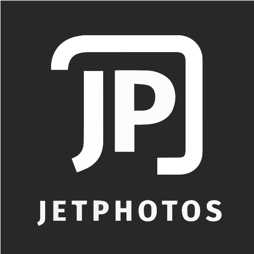 | JetPhotos | `JETPHOTOS` | a link |
|  | Kaggle | `KAGGLE` | a link |
|  | KakaoTalk | `KAKAOTALK` | a link |
|  | Keybase | `KEYBASE` | a link |
| 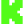 | Kick | `KICK` | a link |
|  | Kickstarter | `KICKSTARTER` | a link |
|  | Kit | `KIT` | a link |
|  | Ko-fi | `KOFI` | a link |
|  | Last.fm | `LASTFM` | a link |
|  | LeetCode | `LEETCODE` | a link |
|  | Lemmy | `LEMMY` | a link |
|  | Letterboxd | `LETTERBOXD` | a link |
|  | Line Messenger | `LINE` | a link |
|  | LinkedIn | `LINKED_IN` | a link |
|  | Mailchimp | `MAILCHIMP` | a link |
|  | Makerworld | `MAKERWORLD` | a link |
|  | Mastodon | `MASTODON` | a link |
|  | Matrix | `MATRIX` | a link |
|  | Medium | `MEDIUM` | a link |
|  | Meetup | `MEETUP` | a link |
|  | Messenger | `FACEBOOK_MESSENGER` | a link |
|  | Microblog | `MICRO_BLOG` | a link |
|  | Mixcloud | `MIXCLOUD` | a link |
|  | MyAnimeList | `MYANIMELIST` | a link |
| 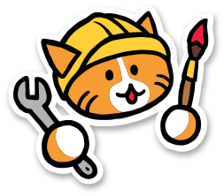 | Neocities | `NEOCITIES` | a link |
|  | Nextcloud | `NEXTCLOUD` | a link |
|  | Nostr | `NOSTR` | a link |
|  | Notion | `NOTION` | a link |
|  | Obsidian | `OBSIDIAN` | a link |
|  | OnlyFans | `ONLYFANS` | a link |
|  | ORCID | `ORCID` | a link |
|  | osu! | `OSU` | a link |
|  | Overcast | `OVERCAST` | a link |
|  | Patreon | `PATREON` | a link |
|  | PayPal | `PAYPAL` | a link |
|  | PeerTube | `PEERTUBE` | a link |
|  | Pillowfort | `PILLOWFORT` | a link |
|  | Pinterest | `PINTEREST` | a link |
|  | Pixelfed | `PIXELFED` | a link |
|  | PlayStation | `PLAYSTATION` | a link |
|  | Pocket Casts | `POCKET_CASTS` | a link |
| 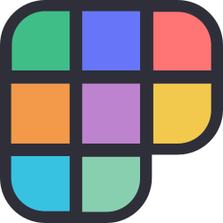 | Polywork | `POLYWORK` | a link |
|  | Printables | `PRINTABLES` | a link |
|  | Private Bin | `PRIVATEBIN` | a link |
|  | Product Hunt | `PRODUCT_HUNT` | a link |
|  | Reddit | `REDDIT` | a link |
|  | RSS | `RSS` | a link |
|  | Rumble | `RUMBLE` | a link |
|  | Semantic Scholar | `SEMANTICSCHOLAR` | a link |
|  | Serializd | `SERIALIZD` | a link |
|  | Session | `SESSION` | a link |
|  | Shazam | `SHAZAM` | a link |
|  | Shop | `SHOPIFY` | a link |
|  | Signal | `SIGNAL` | a link |
|  | Simplex | `SIMPLEX` | a link |
|  | Skoob | `SKOOB` | a link |
| 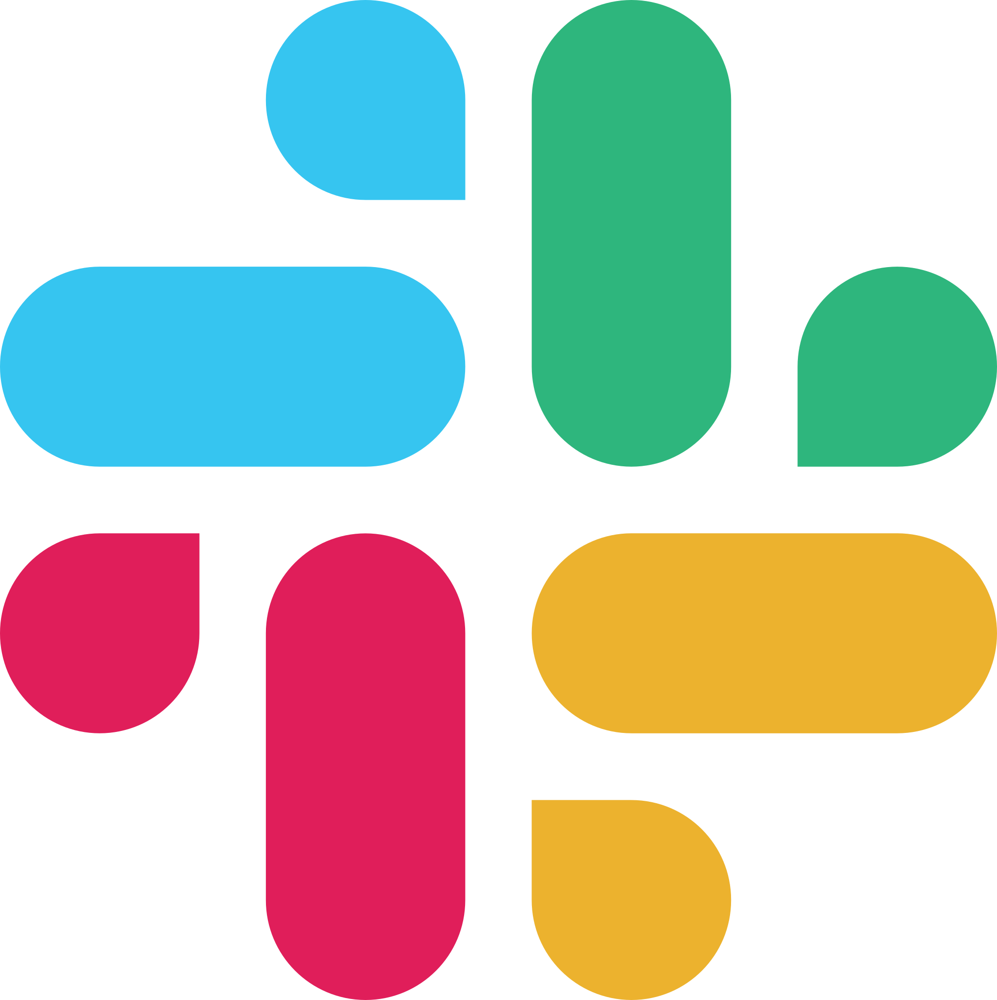 | Slack | `SLACK` | a link |
|  | Snapchat | `SNAPCHAT` | a link |
|  | SoundCloud | `SOUND_CLOUD` | a link |
| 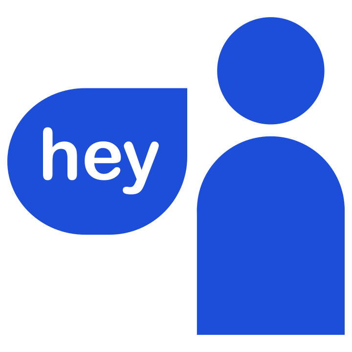 | SpaceHey | `SPACEHEY` | a link |
|  | Spotify | `SPOTIFY` | a link |
|  | Stack Overflow | `STACKOVERFLOW` | a link |
| 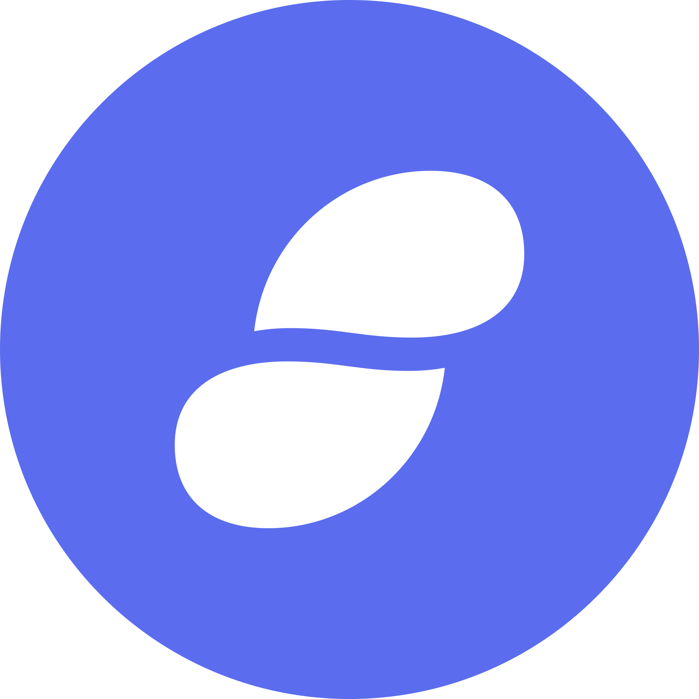 | Status | `STATUS` | a link |
|  | Steam | `STEAM` | a link |
|  | Strava | `STRAVA` | a link |
|  | Streamlabs | `STREAMLABS` | a link |
| 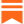 | Substack | `SUBSTACK` | a link |
| 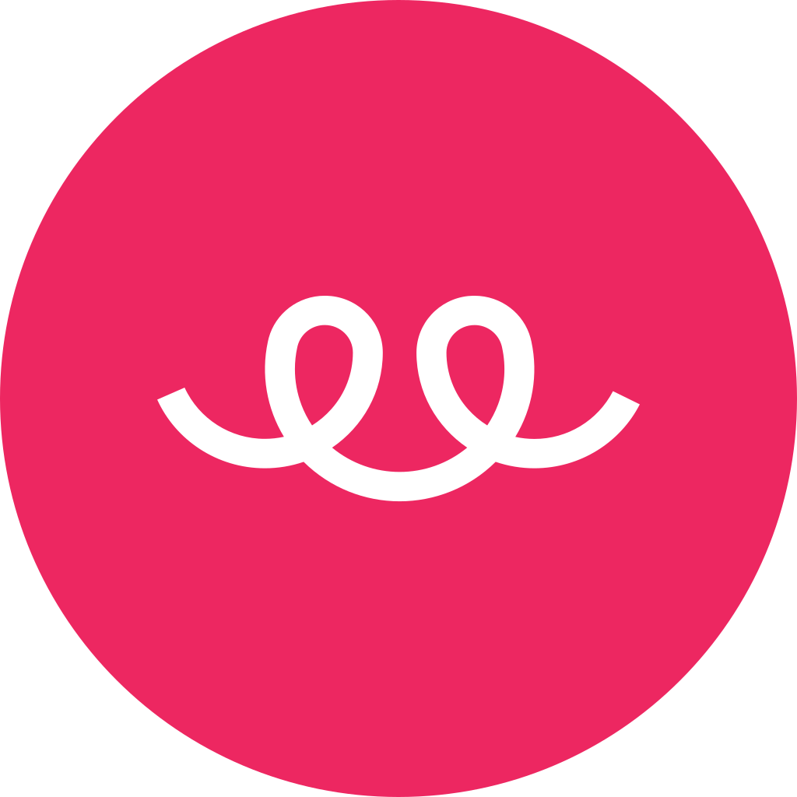 | Teespring | `TEESPRING` | a link |
|  | Telegram | `TELEGRAM` | a link |
|  | Text me | `SMS` | a phone number |
| 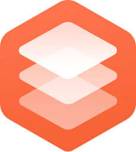 | The Poster Database | `TPDB` | a link |
|  | The StoryGraph | `THESTORYGRAPH` | a link |
|  | Threads | `THREADS` | a link |
|  | Threema | `THREEMA` | a link |
|  | Tidal | `TIDAL` | a link |
|  | TikTok | `TIKTOK` | a link |
|  | Trakt | `TRAKT` | a link |
|  | Tripadvisor | `TRIPADVISOR` | a link |
|  | Tumblr | `TUMBLR` | a link |
|  | Twitch | `TWITCH` | a link |
|  | Twitter | `TWITTER` | a link |
|  | Unsplash | `UNSPLASH` | a link |
|  | Untappd | `UNTAPPD` | a link |
|  | Upwork | `UPWORK` | a link |
|  | Venmo | `VENMO` | a link |
|  | VERO | `VERO` | a link |
|  | Viber | `VIBER` | a link |
|  | Vimeo | `VIMEO` | a link |
|  | VRChat | `VRCHAT` | a link |
|  | VSCO | `VSCO` | a link |
|  | Website | `WEBSITE` | a link |
|  | WeChat | `WECHAT` | a link |
|  | Weibo | `WEIBO` | a link |
|  | Wellfound | `WELLFOUND` | a link |
|  | WhatsApp | `WHATSAPP` | a link |
|  | WordPress | `WORDPRESS` | a link |
|  | X | `X` | a link |
|  | Xbox | `XBOX` | a link |
|  | Xing | `XING` | a link |
|  | Yelp | `YELP` | a link |
|  | YouTube | `YOUTUBE` | a link |
|  | YouTube Music | `YOUTUBE_MUSIC` | a link |
|  | Zelle | `ZELLE` | a link |
|  | Zoom | `ZOOM` | a link |

Generated by `scripts/build_platform_docs.mjs` from [app/platforms.mjs](../app/platforms.mjs). Icon sources
and licences: [THIRD-PARTY-NOTICES.md](../THIRD-PARTY-NOTICES.md). Platform names and logos are trademarks
of their owners.
