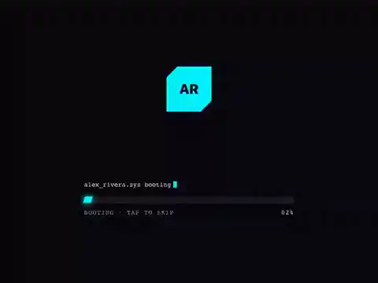
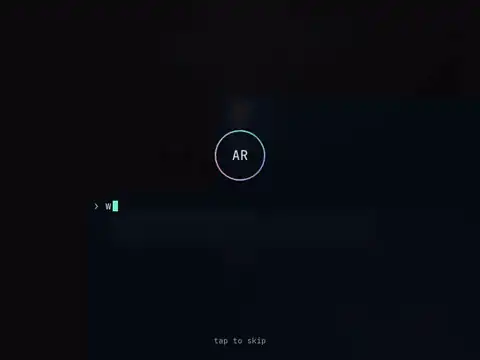
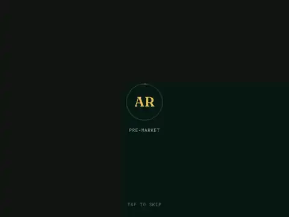
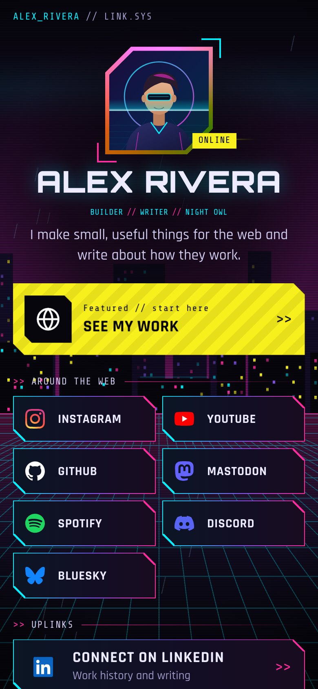
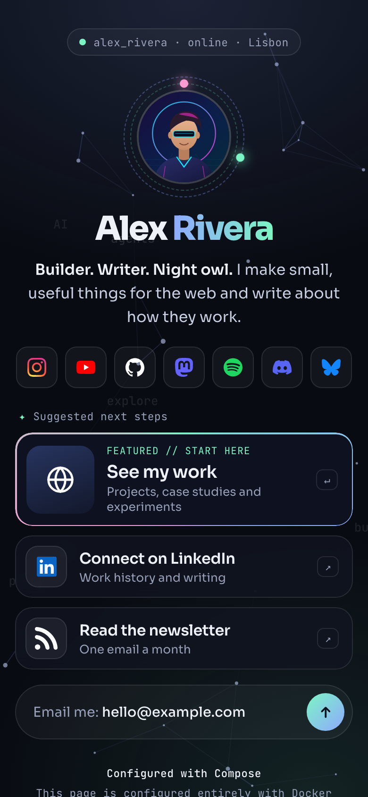
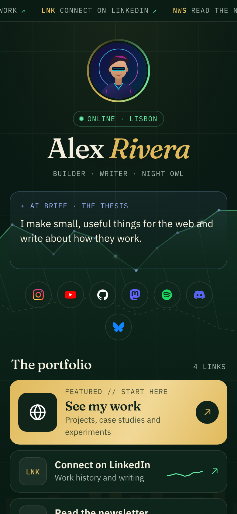

# Themes

`THEME` selects the design. Every theme reads the same variables, so switching keeps your content.
Rows marked "Neon:" in the [configuration reference](configuration.md) affect only the Neon design.

| Theme | Look | Loader | Fonts |
| --- | --- | --- | --- |
| `neon` (default) | Cyberpunk night city with rain and light trails, glitch effects, cut-corner panels | Typed boot log, block meter, "Access granted" | Orbitron, Rajdhani, Share Tech Mono |
| `neural` | Dark AI answer over a drifting neural network, soft gradient borders | The question types itself, the status thinks, the bio streams in | Sora, JetBrains Mono |
| `opening-bell` | Calm investing app in deep green, cream and gold; links shown as positions with tickers | A chart draws, a ring fills, the bell rings and the curtain lifts | Fraunces, IBM Plex Sans, IBM Plex Mono |

### Loaders

| Neon | Neural | Opening Bell |
| --- | --- | --- |
|  |  |  |

### On a phone

| Neon | Neural | Opening Bell |
| --- | --- | --- |
|  |  |  |

Wording marked "theme default" in the reference follows the selected theme unless you set it.
The tickers, charts and sparklines in Opening Bell are decoration, not market data.

## Shared behaviour

- **Reduced motion:** with the system setting on, the loader is skipped and backgrounds stay still.
- **No JavaScript:** the page and every link still work; only the animations are missing.
- **Keyboard:** a skip link, visible focus and a tab order that follows the visual order.
- **Fonts** are self-hosted, so a theme makes no third-party requests (see
  [THIRD-PARTY-NOTICES.md](../THIRD-PARTY-NOTICES.md)).
- `BOOT_MODE` controls the loader in every theme: `full`, `short`, `once` (first visit in a browser
  session) or `off`. Its wording comes from your settings; see the
  [loader tokens](configuration.md#loader-tokens-and-examples).

## Add a theme

1. Create `app/themes/<name>/theme.mjs` exporting `meta` (`name`, `title`, `themeColor`),
   `page(config, parts)`, `favicon(sigil)` and `avatar(initials)`. `parts.head(styles)` and
   `parts.scripts(sources)` write the shared metadata, stylesheet and script tags.
2. Put CSS, scripts and fonts in `app/themes/<name>/public/` (served at `/theme/`). Only
   same-origin scripts are allowed by the Content-Security-Policy, so no inline script.
3. Register it in [app/themes/index.mjs](../app/themes/index.mjs).
4. Run `make verify`: the contract test in [tests/themes.test.mjs](../tests/themes.test.mjs) checks
   every registered theme (escaping, all links present, fallbacks).
5. Run `make up`, then `make browser` at 390, 900 and 1440 px, and `make media` to add screenshots.
